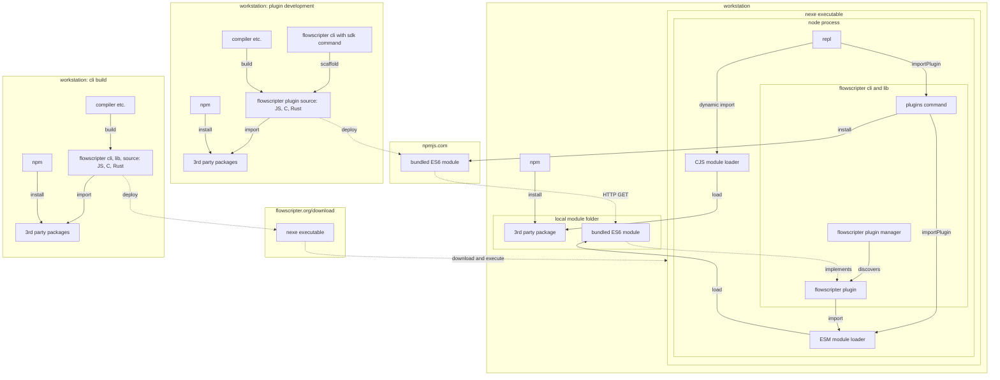

### Install

**Status: Planned**

Download and unzip from [https://flowscripter.org/download](https://flowscripter.org/download)

### First Run

**Status: Planned**

From a terminal:

`flowscripter` 

An initial prompt to share usage data will be displayed and a settings file will be created at:

`~/.flowscripter/settings.yaml`

with the following contents:

```
[cli]
submit_usage_stats = true # anonymous submission of CLI usage to help improve Flowscripter

[packages] # advanced(!) configuration for Flowscripter wrapping of node npm functionality 
prefix=~/.flowscripter/node_modules # location of node_modules folder for packages downloaded by Flowscripter
scope=@flowscripter # scope to use for Flowscripter plugin packages
```

### Basic Help

**Status: Planned**

`flowscripter --help` or `flowscripter`

which returns:

```
Usage: flowscripter [<options>] <command> [<arguments>]

Options:

	--settings=<filepath>	Use settings from <filepath> (defaults to '~/.flowscripter/settings.toml').

Core commands:

    help            Display this help message. Use 'help <command>' for detailed help.
    version         Display Flowscripter version.
    self-update     Update Flowscripter.
    install         Install command and component plugins.
    search          Search command and component plugins.
    uninstall       Remove installed command and component plugins.
    versions        Display version information for installed command and component plugins.
    update          Update installed command and component plugins.
    script          Execute a script using Flowscripter and display the result.
    repl            Start Flowscripter in REPL interactive mode.

Core components:

    file
    plugin
    
Installed commands:

    None!
	
Installed components:

    None!
```

#### Basic Commands

**Status: Planned**

`flowscripter version`

which returns:

```
1.1.0

Your version of Flowscripter is out of date! The latest version is 1.2.1 
You can update by downloading from flowscripter.org or on the command line via 'flowscripter self-update'
```

Possibly followed by (for example):
```
The following plugins are not compatible with the current version and will need to be updated via 'flowscripter update':

    mxf-model
```

`flowscripter self-update`

which returns:

```
Updated Flowscripter to v1.2.1
```

Possibly followed by (for example):
```
The following plugins are not compatible with the current version and will need to be updated via 'flowscripter update':

    mxf-model
```

#### Installing a Command

**Status: Planned**

`flowscripter install mxf-metadata-extract-command`

which returns:

```
@flowscripter/bmx@1.10.1
@flowscripter/bmx-model@1.10.1
@flowscripter/bmx-extractor@1.10.1
@flowscripter/mxf-metadata-extract-command@1.10.1
```

and results in a new folder and module sub-folders:

```
~/.flowscripter/node_modules/@flowscripter/bmx
~/.flowscripter/node_modules/@flowscripter/mxf-model
~/.flowscripter/node_modules/@flowscripter/bmx-extractor
~/.flowscripter/node_modules/@flowscripter/mxf-metadata-extract-command
```

Now when you run `flowscripter --help` the return includes:

```
Installed commands:

    @flowscripter/mxf-metadata-extract@1.10.1    Display metadata extracted from an MXF file.
	
Installed components:

    @flowscripter/bmx@1.10.1                     MXF file functionality courtesy of BMXLib
    @flowscripter/mxf-model@1.10.1               MXF file model
    @flowscripter/bmx-extractor@1.10.1           MXF metadata extract operator using BMXLib
	
```

The `mxf-metadata-extract-command` package is a Flowscripter command plugin and makes use of the `bmx` and `mxf-model` 
component plugins.

Running:

`flowscripter help mxf-metadata-extract`

returns:

```
Description: 

    Display metadata extracted from an MXF file.

Usage:

    flowscripter mxf-metadata-extract <arguments>

Arguments:

    -url=<mxf_file_url>        The URL of an MXF from which to extract metadata.
```

#### REPL Example

**Status: Planned**

`flowscripter repl`

which returns:

```
> 
```

A user can then interactively enter Javascript:

```
import { BmxExtractor } from '@flowscripter/bmx-extractor';
```

Further Javascript logic will allow the user to achieve the same effect as using the wrapped command:

`flowscripter mxf-metadata-extract -url=~/test.mxf`

A plugin can also be installed dynamically within the REPL:

```
import { PluginManager } from '@flowscripter/plugin';

myTestPlugin = PluginManager.importPlugin('my-test-component');

```

The above will perform the equivalent of:
 
`flowscripter install my-test-component`

Now when you run `flowscripter --help` the return includes:

```
Installed components:

    my-test-component          My test component
```

#### Script Example

**Status: Planned**

A pre-existing script can be executed using:

`flowscripter script -file=script.js`

#### SDK Support

**Status: Planned**

To develop command and component plugins, you need to install the Flowscripter SDK:

`flowscripter install sdk`

which returns:

```
@flowscripter/sdk@1.10.1
```

and results in a new folder and module sub-folders:

```
~/.flowscripter/node_modules/@flowscripter/sdk
```

Now when you run `flowscripter --help` the return includes:

```
Installed commands:

    scaffold      Create a new SDK project for a Flowscripter plugin.
    build         Build a Flowscripter plugin.
    deploy        Publish a Flowscripter plugin.
```

##### npm and 3rd Party Packages

**Status: Planned**

To build a plugin you will need `npm` installed.

When you scaffold a new project it will include a `package.json` file and suitable build scripts to build
 the Javascript plugin for usage in the NodeJS runtime.

If you configure `npm` (using `prefix`) and the Flowscripter `settings.yaml` file to use 
the same modules prefix, you can use `npm` to manage 3rd party packages you wish to import within your plugin.

#### Module and Plugin Framework

**Status: Planned**



The flowscripter plugin and npm need to use the same local module folder when using npm and the flowscripter REPL or SDK.
