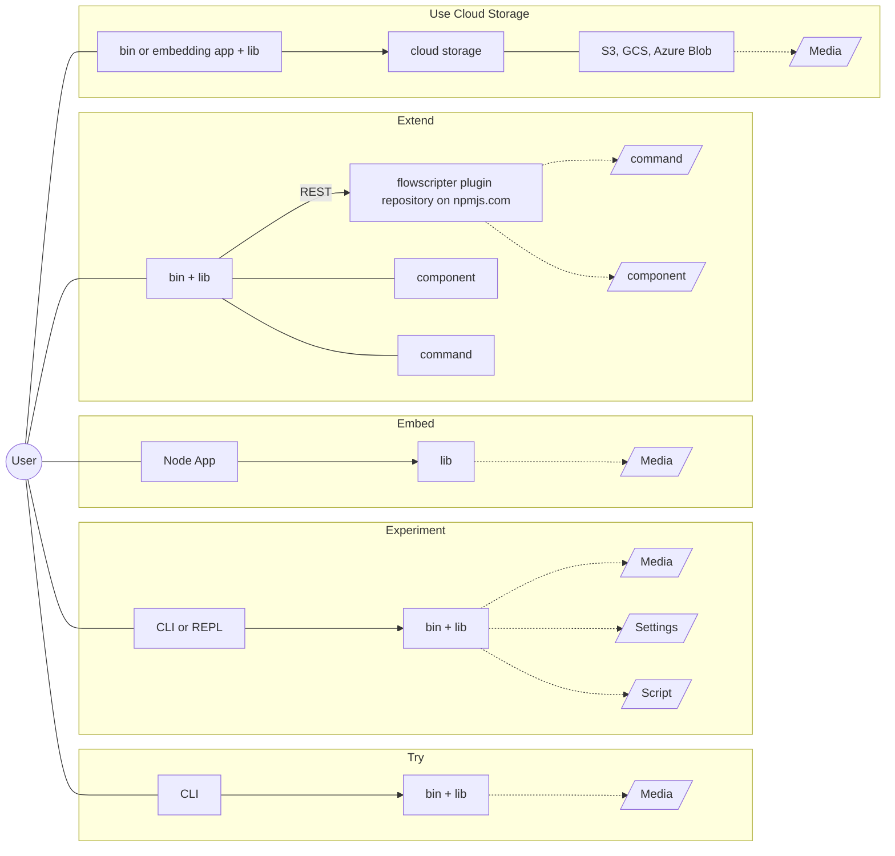
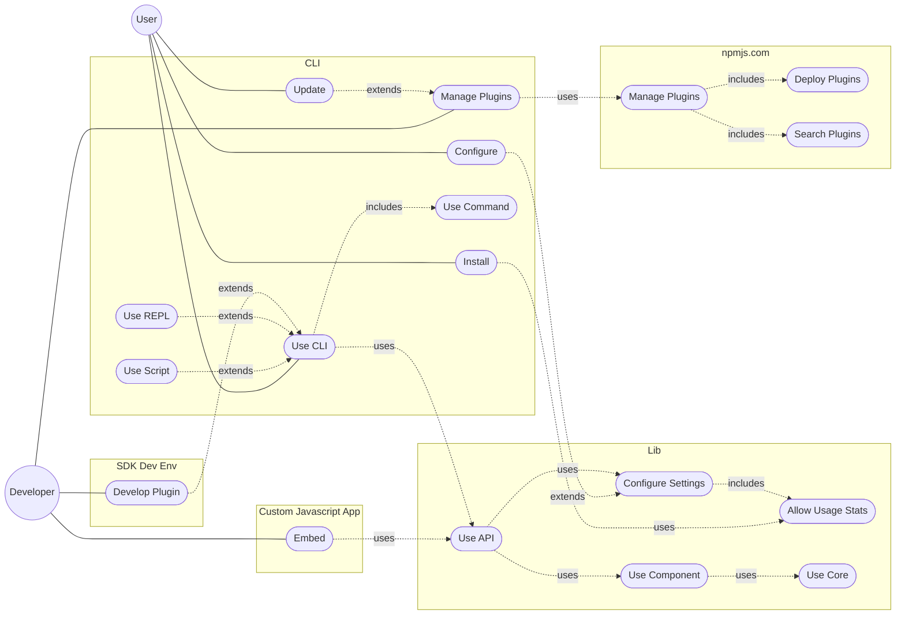
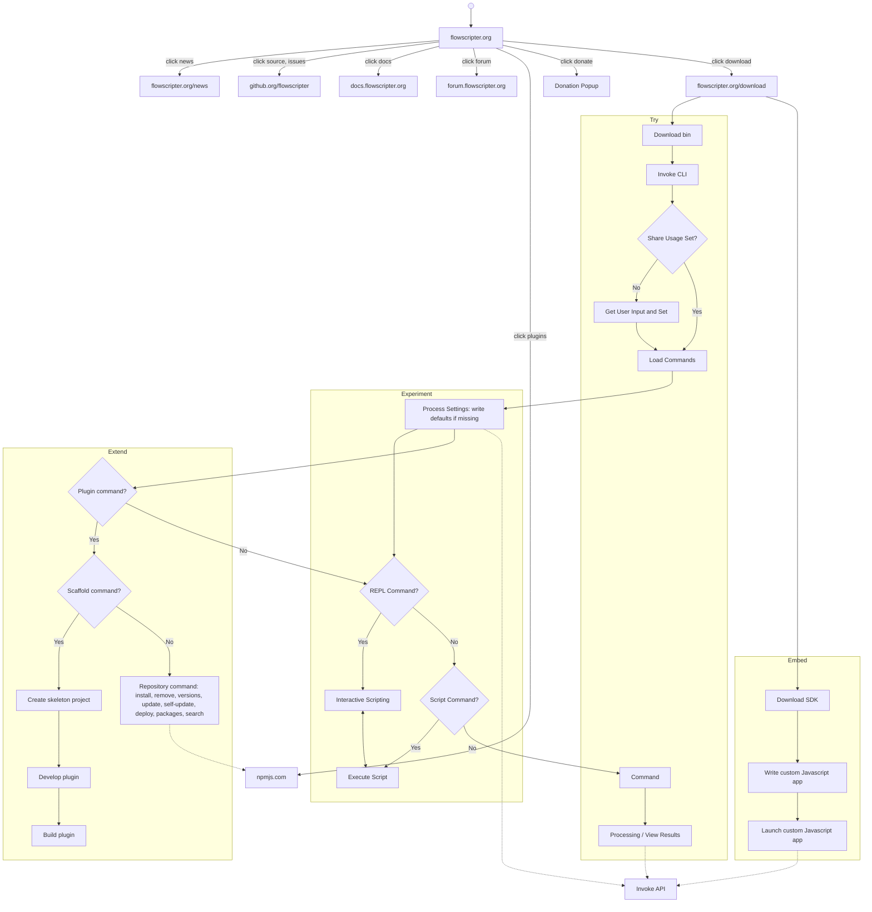

#### Documentation

**Status: Planned**

- Website homepage demo of terminal based CLI install and usage
- User guide: CLI, REPL
- Scripting guide
- Developer guide: 
    - embedding (e.g. using the Lib API)
    - feature development via commands and components (e.g. using the Component API)
- Lib API generated documentation and sample code
- Component API generated documentation and sample code
- Component documentation e.g. implemented operators, models etc.
- Codebase generated documentation
- Build instructions and design overview

#### CLI

**Status: Planned**

- Cross platform, command line executable
- Simple download and run
- Pretty coloured text
- Initial prompt to opt-in for usage reporting
- Plugin (command, component) discovery and installation at runtime
- Core built-in commands:
	- update and self-update
	- agent mode
	- REPL
	- plugin management
- No core built-in components

#### REPL

**Status: Planned**

- Launched from CLI
- Provides scripted access to lib API

#### Configuration

**Status: Planned**

- Configurable settings for CLI and core library
- YAML configuration file
- Library configured via API
- CLI reads configuration file and configures itself and library via API

#### Embeddable Library

**Status: Planned**

- Cross platform library
- Javascript API
- Component plugins can be installed and loaded

#### Extensible

**Status: Planned**

- Plugins for Commands and Components
- Component types such as operators, payload types, scripting objects, events and models
- Plugin lifecycle management via CLI e.g. scaffold, build, install, update, deploy
- Support for local/remote plugin repositories
- Plugin SDK for Rust and C++
- Dynamic discovery, install and loading of plugins
- Cross platform
- Configuration options can be added by plugins
- Commands are scripts with argument declarations
- CLI arguments can be added by command plugins

#### Example Plugins

**Status: Planned**

- OpenEXR
- MXF
- IMF
- MPEG
- MP4
- YouTube 
- S3
- wavtotext
- bmxlib
- ffmpeg
- Editor similar to MoviePy
- Generator similar to MoviePy

#### Example Use Cases

**Status: Planned**

- Extract info e.g. JSON output to local or remote sink
- Extract media e.g. media output to local or remote sink
- Validate e.g. bitstream validate, metadata value validate
- Duplicate e.g. local source to remote sink
- Update metadata e.g. updating parsed model when writing out, updating length and offsets as necessary
- Create/update media e.g. write out new media file with source media and metadata added
- Fix e.g. stream based replacement of values, parsing, handling bitstream errors and fixing, updating length and offsets as necessary
- Transcode e.g. decode and re-encode streamed media data
- Render e.g. rendered media data
- Analyse e.g. higher level processing of streamed data such as audio level analysis, then output as a streamed analysis model
- Stream in e.g. real-time/live processing of streamed media data
- Stream out e.g. real-time/live processing of streamed media data or streamed analysis data
- Expose VFS e.g. parse file, expose as constituent files which can be streamed out directly

#### Usage Scenarios

**Status: Planned**

- Try: immediate cross-platform binary download and immediate CLI usage
- Experiment: flexibility and automation using the CLI or REPL with settings and scripts
- Embed: embedding the library in JavaScript
- Extend: publish, discover, install and load plugins providing components and/or command extensions
- Use cloud storage: hybrid storage access, intelligent random access, install a module and configure access keys

#### Use Cases

**Status: Planned**

#### User Journeys

**Status: Planned**

